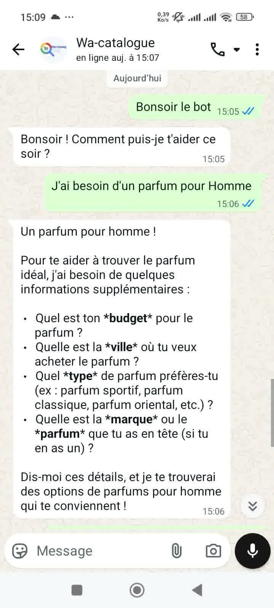
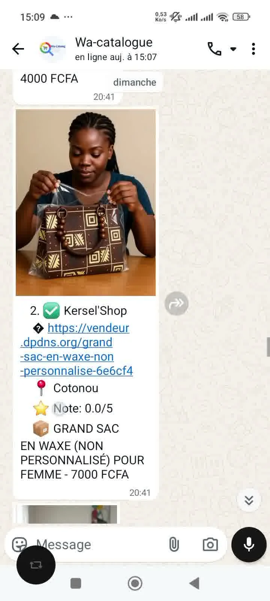
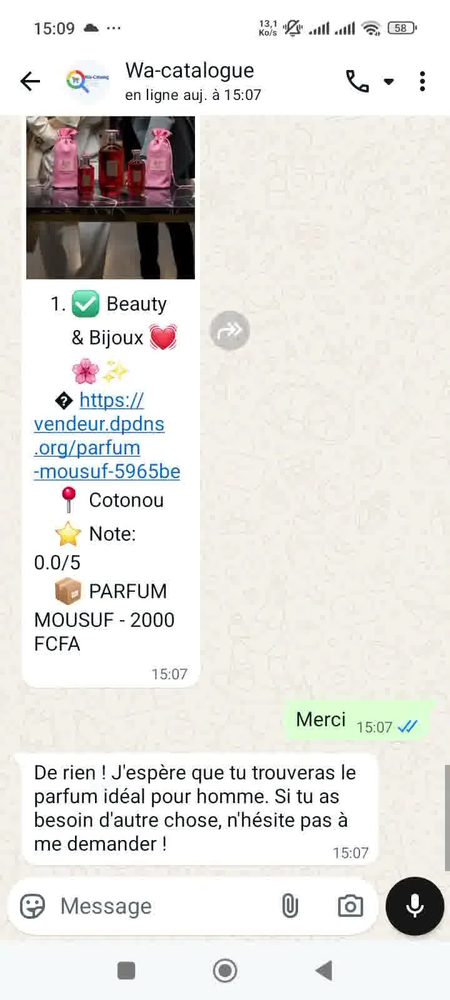
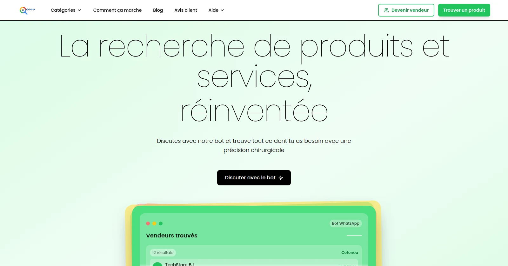

# wa-catalog

> A WhatsApp shopping assistant that searches the catalogs of WhatsApp Business sellers in Benin and connects buyers with the right seller in a single message.

🌐 **Website:** [wa-catalog.store](https://wa-catalog.store)

🎥 **Demo video:** [Watch wa-catalog in action on WhatsApp](https://res.cloudinary.com/dwsjriapi/video/upload/v1792613380/mo5rvp6dnnza2zkpm1dd.mp4)

## The problem
In Benin, a large share of retail happens on WhatsApp: sellers publish products in WhatsApp Business catalogs and statuses, but those catalogs are locked inside the app and invisible to new customers. Buyers end up messaging several sellers and scrolling through statuses and groups to find one product, with no way to know which sellers are reliable.

## What it does
- Buyers describe what they want in plain language on WhatsApp ("an HP laptop under 250k in Cotonou") and get matching products from indexed seller catalogs.
- Natural-language-to-SQL search over the product database, with category and keyword handling tuned for local vocabulary.
- One-tap contact with the seller directly on WhatsApp.
- Seller portal and admin back-office to onboard sellers, add products with photos, and track searches and buyer contacts.
- Public website explaining how it works, with seller sign-up.

## Screenshots
| Buyer request | Matching sellers | Result and follow-up | Product media |
|---|---|---|---|
|  |  |  |  |

## Tech stack
- **Interface:** WhatsApp via whatsapp-web.js · seller portal and admin in Express + EJS
- **Backend:** Node.js, Express, LangChain (with MCP adapters)
- **LLM:** Groq (`qwen/qwen3-32b`, `openai/gpt-oss-120b`, `llama-3.1-8b-instant` for fast routing)
- **Data:** Supabase (PostgreSQL) · Cloudinary for product images
- **Hosting:** Docker on a VPS (Dokploy) · website on Vercel

## Status
- [x] WhatsApp bot live with natural-language product search
- [x] Seller portal and admin dashboard
- [x] Public website: [wa-catalog.store](https://wa-catalog.store)
- [ ] Migration to the official WhatsApp Business API (in progress)

## Source code
The source code is private for commercial reasons. Access can be provided on request for evaluation purposes.

## Contact
Arès GNIMAGNON, Founder & CEO of [SINDA SARL](https://www.sinda.pro/) · [LinkedIn](https://bj.linkedin.com/in/ar%C3%A8s-gnimagnon-a239353b8/) · [aresgnimagnon0@gmail.com](mailto:aresgnimagnon0@gmail.com)
